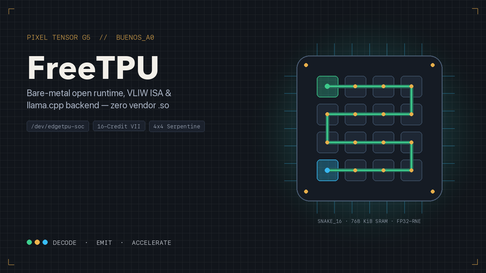
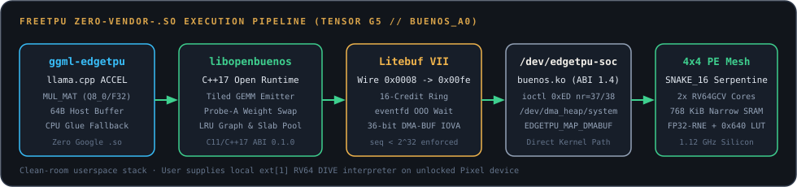

<p align="center">
  <picture>
    <source media="(prefers-color-scheme: dark)" srcset=".github/assets/hero-banner-dark.png">
    <source media="(prefers-color-scheme: light)" srcset=".github/assets/hero-banner-light.png">
    
  </picture>
</p>

<p align="center">
  <a href="LICENSE"></a>
  
  
  
  <a href=".github/workflows/ci.yml"></a>
</p>

<p align="center">
  <a href="#60-second-quickstart">Quickstart</a> &middot;
  <a href="#architecture">Architecture</a> &middot;
  <a href="#verified-silicon--host-results">Benchmarks</a> &middot;
  <a href="#documentation">ISA Docs</a> &middot;
  <a href="#clean-room-boundaries--firmware-extraction">Clean-Room Boundary</a> &middot;
  <a href="#extracting-dive_interp_rv64bin-on-device">Extract Firmware</a>
</p>

<p align="center">
  <strong>Clean-room userspace runtime, closed-form VLIW ISA synthesizer, and <code>llama.cpp</code> GGML backend driving Google Pixel Tensor G5 TPU directly over <code>/dev/edgetpu-soc</code> with zero proprietary vendor <code>.so</code> dependencies.</strong>
</p>

---

## Architecture

<p align="center">
  
</p>

| Layer | Component | Responsibility |
| --- | --- | --- |
| **LLM Inference** | [`llama-cpp-edgetpu/`](llama-cpp-edgetpu/README.md) | `EDGETPU` GGML `ACCEL` backend (`MUL_MAT` `Q8_0` / `F32`, 64B host storage, CPU glue fallback) |
| **Open Runtime** | [`libopenbuenos/`](libopenbuenos/include/openbuenos.h) | C11/C++17 static library: DMA-BUF slab pool, LRU graph cache, 16-credit VII ring, closed-form VLIW GEMM emitter |
| **Kernel Transport** | [`runtime/`](runtime/src/tpu_baremetal_runner.cpp) | Standalone bare-metal runner & UAPI/Litebuf VII headers (`0x0008 -> 0x00fe`, `/dev/edgetpu-soc` `0xED`) |
| **ISA Tooling** | [`tools/`](tools/emit_custom_gemm.py) | Pure-Python `DGC0` dissector/patcher, multi-tile `(M, K, N)` VLIW synthesizer, `0x640` minimax spline codec, `INT4` packer |

---

## 60-Second Quickstart

Build `libopenbuenos`, verify strict C11/C++17 headers, and run the offline unit test suite (zero device or proprietary `.dgc0` files required):

```bash
git clone https://github.com/saariuslystoned/freetpu.git
cd freetpu

# 1. Build & test libopenbuenos (CMake + host mock mode)
cmake -S libopenbuenos -B libopenbuenos/build/cmake-host -DCMAKE_BUILD_TYPE=Release
cmake --build libopenbuenos/build/cmake-host -j
ctest --test-dir libopenbuenos/build/cmake-host --output-on-failure

# 2. Run clean-room Python VLIW ISA & 0x640 minimax spline self-tests
python3 tools/emit_custom_gemm.py --self-test
python3 tools/spline_0x640.py --self-test --no-emit
python3 tools/pack_int4.py
```

To cross-build `libopenbuenos.a`, `tpu_baremetal_runner`, and `llama.cpp` (`llama-cli` / `llama-bench` / `test-backend-ops`) for Android ARM64 (`android-34`):

```bash
make -C libopenbuenos verify-header android verify-android
make -C runtime verify-baremetal
```

See [llama-cpp-edgetpu/README.md](llama-cpp-edgetpu/README.md) for patching upstream `ggml-org/llama.cpp` (`b12608`).

---

## Verified Silicon & Host Results

All hardware metrics below were measured on Google Pixel 10 Pro Fold (`rango`, Tensor G5 `buenos_a0`, `buenos.ko` ABI `1.4`) with `/proc/self/maps` confirming zero loaded Google/vendor `.so` libraries:

| Proof Suite | Scope | Verified Result |
| --- | --- | --- |
| **Closed-Form Multi-Tile ISA** | `81` compiled reference models across `M=1..64, K=4..512, N=4..128` | **`81/81` bit-exact** `chunk[0..6]`, `ext[0]` (`DIVE`), `ext[2]` (`verify_full_isa_81.py`) |
| **Novel Bare-Metal Multi-Tile Kernels** | `7` custom `(M, K, N)` GEMM microkernels (no TFLite compiler) | **`3,368/3,368` output bytes exact** (`max_abs_err = 0`), `420–504 us` HW (`~2.3x–3.7x` faster mean wall latency vs vendor stack) |
| **`0x640` Minimax Splines & Fusion** | `SiLU`, `GELU`, `exp(x)` probes + `4` Mode-A fused `GEMM + SiLU/GELU` probes | **`12,288/12,288` bytes exact** (`max_abs_err = 0`, `461–600 us` HW), `+0 B` fusion overhead |
| **`libopenbuenos` Live Silicon Self-Test** | `16x128x128`, `1x512x256`, `1x576x1536`, `16x576x576` (`INT8` & `F32 x Q8_0`) | **`max_abs_err = 0`** (`INT8`), `f32_nmse <= 1.87e-4`, `100%` token-invariant cache hits (`36/36`, `81/81`) |
| **`ggml-edgetpu` Backend Ops** | `test-backend-ops -b EDGETPU -o MUL_MAT` (`Q8_0`/`F32`) | **`223/223` PASS** (`104/104` `q8_0 x f32`), `DT_NEEDED = [libdl.so, libm.so, libc.so]` |

---

## Clean-Room Boundaries & Firmware Extraction

`freetpu` is strictly **clean-room source and specification only**:

- **Zero vendor binaries**: No proprietary `.so`, `.ko`, `.img`, `.apk`, `.gguf`, `.tflite`, `.dgc0`, or firmware blobs are included in this repository.
- **Zero vendor userspace dependencies**: `libopenbuenos`, `tpu_baremetal_runner`, and `ggml-edgetpu` talk directly to the Linux kernel (`/dev/edgetpu-soc` and `/dev/dma_heap/system`).
- **Host mock mode**: Setting `ob_config_t::mock_mode = 1` (or `OPENBUENOS_MOCK=1`) runs the full buffer pool, graph LRU cache, 16-credit async ring, VLIW emitter, and quantized math suites offline on macOS/Linux without TPU hardware.

### Extracting `dive_interp_rv64.bin` On-Device

Running synthesized `.dgc0` microkernels on physical Tensor G5 hardware requires the `638,977 B` RV64GCV DIVE VM interpreter image (`ext[1]`) from the user's own device. **Do not redistribute this binary.** Extract it locally on an unlocked Pixel using `libopenbuenos`:

```c
#include "openbuenos.h"
#include <stdlib.h>

size_t interp_size = 0;
ob_gemm_extract_dive_interp_from_dgc0("/path/to/local_compiled.dgc0", NULL, 0, &interp_size);
uint8_t *buf = (uint8_t *)malloc(interp_size);
ob_gemm_extract_dive_interp_from_dgc0("/path/to/local_compiled.dgc0", buf, interp_size, &interp_size);
```

Or point `libopenbuenos` / `ggml-edgetpu` directly at your local extracted image (or a local `.dgc0` file) at runtime:

```bash
export OPENBUENOS_DIVE_INTERP_PATH=/data/local/tmp/tpu_open_stack/dive_interp_rv64.bin
```

---

## Documentation

- [Hardware & Driver Specs](docs/hardware-specs.md) — Tensor G5 (`buenos_a0`) geometry, `buenos.ko` ABI, rounding & SRAM layout
- [Litebuf VII Wire Protocol](docs/baremetal-vii/litebuf_vii_protocol.md) — Two-layer `0x0008 -> 0x00fe` command/response framing & 16-credit ring
- [Multi-Tile GEMM ISA](docs/isa-gemm/multitile_gemm_isa.md) — Shadow-CSR bank, `4x4` serpentine grid, 2D DMA rewind, `DIVE`/`DWS0`/`DGC0` layout
- [INT4 (`W4A8`) & Kernel Fusion](docs/isa-gemm/int4_and_fusion_spec.md) — `CSR 0x56`, 4-bit nibble packing (`50%` BW savings), Mode-A `GEMM + SiLU/GELU`
- [`0x640` Minimax Splines](docs/int4-splines/splines_silu_gelu_exp.md) — `208 B` `LoadCoefficientTables` codec & `SiLU`/`GELU`/`exp` Remez tables
- [DMA & TTU Bitfields](docs/isa-dma/dma_ttu_bitfields.md) — `0xa40` / `0x9c0` / `0x940` / `0x980` DMA descriptors & SRAM ring setup
- [Vector ALU ISA](docs/isa-vec/vector_alu_isa.md) — `stream125` FP32-RNE quantization & activation pipeline
- [Kernel UAPI Headers](docs/kernel-abi/README.md) — Clean-room `/dev/edgetpu-soc`, `/dev/gxp`, and GCIP IIF headers
- [`libopenbuenos` Guide](docs/libopenbuenos/README.md) & [`ggml-edgetpu` Guide](docs/llama-cpp-edgetpu/README.md)

---

## License

Licensed under the [Apache License 2.0](LICENSE).
