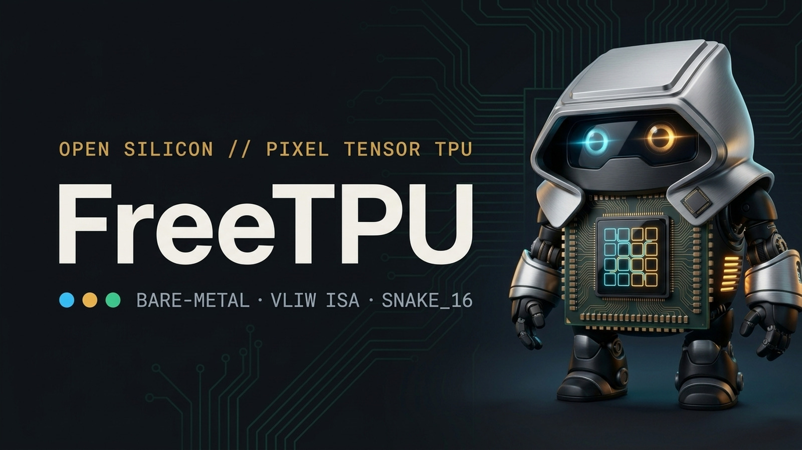
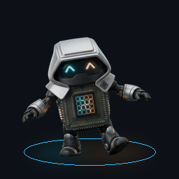

<p align="center">
  <picture>
    <source media="(prefers-color-scheme: dark)" srcset=".github/assets/banner-dark.jpg">
    <source media="(prefers-color-scheme: light)" srcset=".github/assets/banner-light.jpg">
    
  </picture>
</p>

<p align="center">
  <a href="LICENSE"></a>
  
  
  
  <a href=".github/workflows/ci.yml"></a>
</p>

<p align="center">
  <a href="#60-second-quickstart">Quickstart</a> &middot;
  <a href="#architecture">Architecture</a> &middot;
  <a href="#verified-silicon--host-results">Benchmarks</a> &middot;
  <a href="#hardware-errata--w8a16-bf16-unlock">Hardware Errata</a> &middot;
  <a href="#documentation">ISA Docs</a> &middot;
  <a href="#clean-room-boundaries--firmware-extraction">Clean-Room Boundary</a>
</p>

<p align="center">
  <strong>Clean-room userspace runtime, closed-form VLIW ISA synthesizer, and <code>llama.cpp</code> GGML backend driving Google Pixel Tensor G5 TPU directly over <code>/dev/edgetpu-soc</code> with zero proprietary vendor <code>.so</code> dependencies.</strong>
</p>

<p align="center">
  
</p>

---

## Architecture

<p align="center">
  
</p>

| Layer | Component | Responsibility |
| --- | --- | --- |
| **LLM Inference** | [`llama-cpp-edgetpu/`](llama-cpp-edgetpu/README.md) | `EDGETPU` GGML `ACCEL` backend (`MUL_MAT` `Q8_0` / `Q4_0` / `F32`, shared-`A` QKV & gate/up batching, 1D bias `ADD`, 64B host storage) |
| **Open Runtime** | [`libopenbuenos/`](libopenbuenos/include/openbuenos.h) | C11/C++17 static library: `1,286.4 MHz` DVFS + FW WakeLock, FD-capped DMA-BUF pool & `O(1)` weight cache, 16-credit VII ring, `M=1` & `M=64` VLIW GEMM emitter |
| **Kernel Transport** | [`runtime/`](runtime/src/tpu_baremetal_runner.cpp) | Standalone bare-metal runner & UAPI/Litebuf VII headers (`0x0008 -> 0x00fe`, `/dev/edgetpu-soc` `0xED`) |
| **ISA Tooling** | [`tools/`](tools/emit_custom_gemm.py) | Pure-Python `DGC0` dissector/patcher, multi-tile `(M, K, N)` VLIW synthesizer, `0x640` minimax spline codec, `0xa40` chained fusion verifier, `INT4` packer |
| **Cloud TPU Ops** | [`ops/`](docs/cloud-tpu/ops-container-telemetry.md) | Zero-dep Prometheus [`tpu-exporter`](ops/tpu-exporter/README.md) (`0x1ae0` + VFIO + `tpu-info`) & CNCF CDI `v0.6.0` [`freetpu-cdi`](ops/tpu-cdi/README.md) Docker/K8s passthrough |

---

## 60-Second Quickstart

Build `libopenbuenos`, verify strict C11/C++17 headers, and run the offline unit test suite (zero device or proprietary `.dgc0` files required):

```bash
git clone https://github.com/saariuslystoned/freetpu.git
cd freetpu

# 1. Build & test libopenbuenos (CMake + host mock mode)
cmake -S libopenbuenos -B libopenbuenos/build/cmake-host -DCMAKE_BUILD_TYPE=Release
cmake --build libopenbuenos/build/cmake-host -j
ctest --test-dir libopenbuenos/build/cmake-host --output-on-failure

# 2. Run clean-room Python VLIW ISA & 0x640 minimax spline self-tests
python3 tools/emit_custom_gemm.py --self-test
python3 tools/spline_0x640.py --self-test --no-emit
python3 tools/pack_int4.py
```

To cross-build `libopenbuenos.a`, `tpu_baremetal_runner`, and `llama.cpp` (`llama-cli` / `llama-bench` / `test-backend-ops`) for Android ARM64 (`android-34`):

```bash
make -C libopenbuenos verify-header android verify-android
make -C runtime verify-baremetal
```

See [llama-cpp-edgetpu/README.md](llama-cpp-edgetpu/README.md) for patching upstream `ggml-org/llama.cpp` (`b12608`).

---

## Verified Silicon & Host Results

All hardware metrics below were measured on Google Pixel 10 Pro Fold (`rango`, Tensor G5 `buenos_a0`, `buenos.ko` ABI `1.4`) with `/proc/self/maps` confirming zero loaded Google/vendor `.so` libraries:

| Proof Suite | Scope | Verified Result |
| --- | --- | --- |
| **DVFS + FW WakeLock Silicon Unlock** | `1x2048x2048` & `64x1536x1536` (`PM=5` @ `1,286.4 MHz` + Litebuf `AcquireWakeLock`) | **`27.59 GB/s`** (`152 us` HW), **`983.6 INT8 GOPS` @ `177.2 mW` = `5.55 TOPS/W`** (`307 us` HW, `max_abs_err = 0`) |
| **Closed-Form Multi-Tile & Large-Tile ISA** | `92` compiled reference models (`81` base + `6` `lt_1x*` + `5` `lt_64x*`) | **`92/92` bit-exact** `chunk[0..6]`, `ext[0]` (`DIVE`), `ext[2]`; **`16/16`** `libopenbuenos` host suites PASS |
| **`0x640` Minimax Splines & Chained Fusion** | `SiLU`/`GELU`/`exp` + `4` Mode-A (`+0 B`) + `3` multi-op `0xa40` probes (`MLP`, `SwiGLU`, `QKV`) | **`12,288/12,288`** spline bytes + **`3/3`** chained probes (`60.8–72.8 us`, `8/8` `ext[2]` slices bit-exact, `max_abs_err = 0`) |
| **Native `W8A16 (BF16)` FP32-I/O GEMM** | `1x64x32` (`2,048 B` `u8` + `128 B` per-channel `FP32` scales) | **`32/32` bit-exact `FP32`** (`max_abs_err = 0.0`, `411–426 us` HW, zero Google `.so`s) |
| **`ggml-edgetpu` Backend Ops** | Live `rango` `test-backend-ops -b EDGETPU -o MUL_MAT` (`Q8_0` & `Q4_0`) | **`104/104` `q8_0`** & **`104/104` `q4_0`** PASS (`327/327` host mock), `cpu_fallback_slices = 0`, `DT_NEEDED = [libdl.so, libm.so, libc.so]` |
| **Live LLM Throughput & Energy (`llama-bench`)** | `SmolLM2-135M-Q8_0` & `Qwen2.5-1.5B-{Q8_0,Q4_0}` (`PM=5` @ `1,286.4 MHz`, `MAPS_GOOGLE=0`) | **`SmolLM2`**: `pp512 = 563.82 t/s`, `tg64 = 17.36 t/s`; **`Qwen2.5-1.5B-Q8_0`**: `pp512 = 105.87 t/s` (**`-21.5%` system `mJ/tok` vs CPU**), `tg64 = 5.85 t/s`, **`22/22` verbatim CPU token match** |

See [docs/PHASE6_PERF_REPORT.md](docs/PHASE6_PERF_REPORT.md) for the full 18-case ODPM `mJ/tok` energy matrix and silicon scaling tables.

---

## Hardware Errata & `W8A16 (BF16)` Unlock

- **`DEQUANTIZE(INT4) -> FULLY_CONNECTED(FP32)` Compiler Deadlock ([LiteRT#12178](https://github.com/google-ai-edge/LiteRT/issues/12178))**: Live silicon ablation proves Tensor G5 (`buenos_a0`) has **no native 4-bit nibble-unpack DMA or systolic unit**. Descriptor `0x980` (`w8[21] = 1`, `w8[29:22] = zp`) is a **`1:2` hardware `UINT8 -> BFLOAT16` expander** (`BF16(float(u8 - zp))`, `16/16` exact at `398 us`), so emitting `1,024 B` of nibbles delivers `2,048 B` instead of `4,096 B` of `BF16` to the MAC and stalls execution indefinitely. **FreeTPU rule**: unpack `Q4_0` weights once at load time into cached `uint8` DMA-BUFs (same `1 B/weight` TPU DMA bandwidth as `Q8_0`), eliminating per-token CPU unpack overhead.
- **Native `W8A16 (BF16)` FP32-I/O GEMM Unlock**: Unpacking to `2,048 B` `uint8` (`w + 8`) + `128 B` per-channel `float32` scales at `+0x800` executes **`FP32 in -> BF16 MAC (1:2 u8->BF16 weight dequant) -> per-channel FP32 scale -> FP32 out`** natively on silicon in **`411–426 us`** (`32/32` bit-exact `FP32`, `max_abs_err = 0.0`). Local LLMs get full `BF16` activation precision (zero `INT8` clipping loss) at `Q8_0` DRAM bandwidth. See [docs/hardware-errata.md](docs/hardware-errata.md).

---

## Clean-Room Boundaries & Firmware Extraction

`freetpu` is strictly **clean-room source and specification only**:

- **Zero vendor binaries**: No proprietary `.so`, `.ko`, `.img`, `.apk`, `.gguf`, `.tflite`, `.dgc0`, or firmware blobs are included in this repository.
- **Zero vendor userspace dependencies**: `libopenbuenos`, `tpu_baremetal_runner`, and `ggml-edgetpu` talk directly to the Linux kernel (`/dev/edgetpu-soc` and `/dev/dma_heap/system`).
- **Host mock mode**: Setting `ob_config_t::mock_mode = 1` (or `OPENBUENOS_MOCK=1`) runs the full buffer pool, graph LRU cache, 16-credit async ring, VLIW emitter, and quantized math suites offline on macOS/Linux without TPU hardware.

### Extracting `dive_interp_rv64.bin` On-Device

Running synthesized `.dgc0` microkernels on physical Tensor G5 hardware requires the `638,977 B` RV64GCV DIVE VM interpreter image (`ext[1]`) from the user's own device. **Do not redistribute this binary.** Extract it locally on an unlocked Pixel using `libopenbuenos`:

```c
#include "openbuenos.h"
#include <stdlib.h>

size_t interp_size = 0;
ob_gemm_extract_dive_interp_from_dgc0("/path/to/local_compiled.dgc0", NULL, 0, &interp_size);
uint8_t *buf = (uint8_t *)malloc(interp_size);
ob_gemm_extract_dive_interp_from_dgc0("/path/to/local_compiled.dgc0", buf, interp_size, &interp_size);
```

Or point `libopenbuenos` / `ggml-edgetpu` directly at your local extracted image (or a local `.dgc0` file) at runtime:

```bash
export OPENBUENOS_DIVE_INTERP_PATH=/data/local/tmp/tpu_open_stack/dive_interp_rv64.bin
```

---

## Documentation

- [Phase 6 Performance & Energy Report](docs/PHASE6_PERF_REPORT.md) — `1,286.4 MHz` DVFS + WakeLock unlock, `983.6 GOPS` (`5.55 TOPS/W`), batched `M=64` prefill, `SmolLM2`/`Qwen2.5` benchmarks & 18-case ODPM `mJ/tok` sweep
- [Phase 5B Live LLM Spec](docs/PHASE5_LLAMA_TPU_SPEC.md) — `Probe A` dynamic `param_slice`, `O(1)` weight cache, outlier peeling & baseline bring-up
- [DVFS, Power States & WakeLock Spec](docs/baremetal-vii/dvfs_power_states.md) — Corrected `+0x1c..+0x20` Litebuf wire fields, `TpuCorePowerState` (`0x03..0x19`), `MemoryPowerState` (`0x01..0x15`) & FW WakeLock (`union_type=4/5`)
- [Chained Multi-Op Fusion & W8A16(BF16) Spec](docs/isa-gemm/chained_fusion_and_w8a16_spec.md) — Zero-DRAM `0xa40` chaining (`MLP`, `SwiGLU` `0x100` MUL, `QKV` concat) & `W8A16(BF16)` scaling
- [Hardware & Driver Specs](docs/hardware-specs.md) — Tensor G5 (`buenos_a0`) geometry, `buenos.ko` ABI, rounding & SRAM layout
- [Hardware Errata & W8A16 (BF16)](docs/hardware-errata.md) — `DEQUANTIZE(INT4)` deadlock root cause, `Q4_0` caching rule & `W8A16 (BF16)` FP32 GEMM unlock
- [Litebuf VII Wire Protocol](docs/baremetal-vii/litebuf_vii_protocol.md) — Two-layer `0x0008 -> 0x00fe` command/response framing & 16-credit ring
- [Multi-Tile GEMM ISA](docs/isa-gemm/multitile_gemm_isa.md) — Shadow-CSR bank, `4x4` serpentine grid, 2D DMA rewind, `DIVE`/`DWS0`/`DGC0` layout
- [INT4 (`W4A8`) & Kernel Fusion](docs/isa-gemm/int4_and_fusion_spec.md) — `CSR 0x56`, 4-bit nibble packing (`50%` BW savings), Mode-A `GEMM + SiLU/GELU`
- [`0x640` Minimax Splines](docs/int4-splines/splines_silu_gelu_exp.md) — `208 B` `LoadCoefficientTables` codec & `SiLU`/`GELU`/`exp` Remez tables
- [DMA & TTU Bitfields](docs/isa-dma/dma_ttu_bitfields.md) — `0xa40` / `0x9c0` / `0x940` / `0x980` DMA descriptors & SRAM ring setup
- [Vector ALU ISA](docs/isa-vec/vector_alu_isa.md) — `stream125` FP32-RNE quantization & activation pipeline
- [Kernel UAPI Headers](docs/kernel-abi/README.md) — Clean-room `/dev/edgetpu-soc`, `/dev/gxp`, and GCIP IIF headers
- [`libopenbuenos` Guide](docs/libopenbuenos/README.md) & [`ggml-edgetpu` Guide](docs/llama-cpp-edgetpu/README.md)
- [Cloud TPU Ops: Container CDI & Prometheus Telemetry](docs/cloud-tpu/ops-container-telemetry.md) — Zero-dep `tpu-exporter` (`:9400/metrics`) & `freetpu-cdi` CNCF CDI `v0.6.0` (`freetpu.dev/tpu=all`) Docker/K8s manifests

---

## License

Licensed under the [Apache License 2.0](LICENSE).
